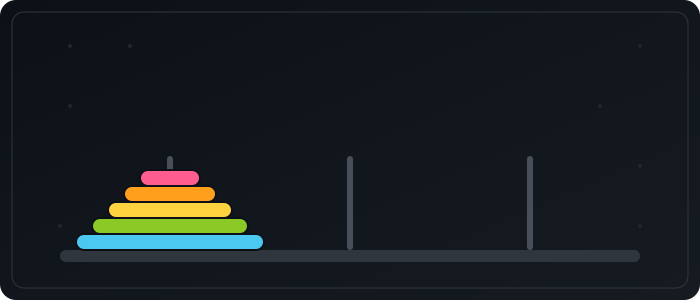

# Структури от данни и алгоритми

  

---

## Съдържание

| # | Седмица |
| :---: | :--- |
| 01 | [Algorithm Complexity](WEEK_01%20-%20Algorithm%20Complexity.md) |
| 02 | [Sorting Algorithms](WEEK_02%20-%20Sorting%20Algorithms.md) |
| 03 | [Search Algorithms](WEEK_03%20-%20Search%20Algorithms.md) |
| 04 | [Linked List](WEEK_04%20-%20Linked%20List.md) |
| 05 | [Stack and Queue](WEEK_05%20-%20Stack%20and%20Queue.md) |
| 06 | [Binary Trees](WEEK_06%20-%20Binary%20Trees.md) |
| 07 | [Hashmap and Hashset](WEEK_07%20-%20Hashmap%20and%20Hashset.md) |
| 08 | [Dynamic Programming](WEEK_08%20-%20Dynamic%20Programming.md) |

---
