# Сортиране

## 1. Bubble Sort (Пузырчеста сортировка)

Идея: минаваме последователно по масива и разменяме всеки два съседни елемента, които са в грешен ред. След всеки пас най-големият неподреден елемент „изплува“ в края на масива, затова всеки следващ пас може да е с един елемент по-къс.

Анимация на bubble sort върху масива `{5, 3, 8, 1, 2}`:



Код:

```cpp
#include <vector>
#include <utility> // за std::swap

void bubbleSort(std::vector<int>& v) {
    int n = v.size();

    for (int i = 0; i < n - 1; i++) {
        bool swapped = false;

        // след i паса последните i елемента вече са на мястото си
        for (int j = 0; j < n - 1 - i; j++) {
            if (v[j] > v[j + 1]) {
                std::swap(v[j], v[j + 1]);
                swapped = true;
            }
        }

        // ако в паса няма нито една размяна, масивът вече е сортиран
        if (!swapped) {
            break;
        }
    }
}
```

Сложност:

| случай | време | памет |
| :--- | :--- | :--- |
| най-добър | $O(N)$ (масивът вече е сортиран) | $O(1)$ |
| среден | $O(N^2)$ | $O(1)$ |
| най-лош | $O(N^2)$ (обърнат масив) | $O(1)$ |

* С оптимизацията с `swapped` best case става $O(N)$, защо?
* Алгоритъмът е стабилен — елементи с еднаква стойност запазват относителния си ред.

---

## 2. Selection Sort (Сортиране чрез избор)

Идея: за всяка позиция от края на масива намираме най-големия елемент в останалата несортирана част `[0..i]` и го разменяме с елемента на позиция `i`. След и-тата стъпка последните `i` елемента вече са сортиран суфикс, т.е. подреждаме най-напред най-големите елементи.

Анимация на selection sort върху масива `{5, 3, 8, 1, 2}`:



Код:

```cpp
#include <vector>
#include <utility> // за std::swap

void selectionSort(std::vector<int>& v) {
    int n = v.size();

    for (int i = n - 1; i > 0; i--) {
        int maxIdx = 0;

        // намираме индекса на най-големия елемент в [0..i]
        for (int j = 1; j <= i; j++) {
            if (v[j] > v[maxIdx]) {
                maxIdx = j;
            }
        }

        // слагаме максимума на позиция i (ако вече не е там)
        if (maxIdx != i) {
            std::swap(v[i], v[maxIdx]);
        }
    }
}
```

Сложност:

| случай | време | памет |
| :--- | :--- | :--- |
| най-добър | $O(N^2)$ | $O(1)$ |
| среден | $O(N^2)$ | $O(1)$ |
| най-лош | $O(N^2)$ | $O(1)$ |

* Прави точно $N \cdot (N-1) / 2$ сравнения във всеки случай, затова best case също е $O(N^2)$.
* Алгоритъмът е нестабилен — размяната може да размести елементи с еднаква стойност.

---

## 3. Insertion Sort (Сортиране чрез вмъкване)

Идея: приемаме, че първите `i` елемента вече са сортирани. Взимаме `i`-тия елемент (key) и го „вмъкваме“ на правилното място в сортирания префикс, като местим по-големите елементи една позиция надясно.

Анимация на insertion sort върху масива `{5, 3, 8, 1, 2}`:



Код:

```cpp
#include <vector>

void insertionSort(std::vector<int>& v) {
    int n = v.size();

    for (int i = 1; i < n; i++) {
        int key = v[i];
        int j = i - 1;

        // местим по-големите от key елементи една позиция надясно
        while (j >= 0 && v[j] > key) {
            v[j + 1] = v[j];
            j--;
        }

        v[j + 1] = key;
    }
}
```

Сложност:

| случай | време | памет |
| :--- | :--- | :--- |
| най-добър | $O(N)$ (масивът вече е сортиран) | $O(1)$ |
| среден | $O(N^2)$ | $O(1)$ |
| най-лош | $O(N^2)$ (обърнат масив) | $O(1)$ |

* Алгоритъмът е стабилен.
* Много ефективен за малки масиви и за почти сортирани масиви — затова често се използва като база в по-сложни сортировки (например в std::sort за малки части).

---

## 4. Merge Sort (Сортиране чрез сливане)

Идея (divide and conquer): разделяме масива на две половини, сортираме ги рекурсивно и накрая сливаме двата сортирани масива в един. Сливането става, като сравняваме по два елемента — по един от всяка половина — и взимаме винаги по-малкия.

Анимация на merge sort върху масива `{5, 3, 8, 1, 2, 7, 4, 6}` (синьо — левият дял, тюркоазено — десният, зелено — вече слято):



Код:

```cpp
#include <vector>

void merge(std::vector<int>& v, int l, int m, int r) {
    std::vector<int> left(v.begin() + l, v.begin() + m + 1);
    std::vector<int> right(v.begin() + m + 1, v.begin() + r + 1);

    int i = 0, j = 0, k = l;

    while (i < left.size() && j < right.size()) {
        if (left[i] <= right[j]) { // <= запазва стабилността
            v[k++] = left[i++];
        } else {
            v[k++] = right[j++];
        }
    }

    while (i < left.size()) v[k++] = left[i++];
    while (j < right.size()) v[k++] = right[j++];
}

void mergeSort(std::vector<int>& v, int l, int r) {
    if (l >= r) return;

    int m = l + (r - l) / 2;
    mergeSort(v, l, m);
    mergeSort(v, m + 1, r);
    merge(v, l, m, r);
}
```

Сложност:

| случай | време | памет |
| :--- | :--- | :--- |
| най-добър | $O(N \log N)$ | $O(N)$ |
| среден | $O(N \log N)$ | $O(N)$ |
| най-лош | $O(N \log N)$ | $O(N)$ |

* Времето е $O(N \log N)$ във всички случаи — масивът се разделя на 2, после на 4, ... общо $\log N$ нива, на всяко ниво се работи по $O(N)$ елемента.
* Алгоритъмът е стабилен, но използва допълнителна памет за временните масиви при сливането.

---

## 5. Quick Sort (Бърза сортировка)

Идея (divide and conquer): избираме елемент **пивот** (в примера — последния) и пренареждаме така, че всички по-малки от пивота да са отляво, а всички по-големи — отдясно. След това рекурсивно сортираме двете части. Тази пренареждаща стъпка се нарича partition.

Анимация на quick sort (Lomuto partition) върху масива `{2, 8, 7, 1, 3, 5, 6, 4}`:



Код:

```cpp
#include <vector>
#include <utility> // за std::swap

// пренарежда [l..r] около пивота и връща финалната му позиция
int partition(std::vector<int>& v, int l, int r) {
    int pivot = v[r];
    int i = l; // граница: всичко преди i е < pivot

    for (int j = l; j < r; j++) {
        if (v[j] < pivot) {
            std::swap(v[i], v[j]);
            i++;
        }
    }

    std::swap(v[i], v[r]);
    return i;
}

void quickSort(std::vector<int>& v, int l, int r) {
    if (l >= r) return;

    int p = partition(v, l, r);
    quickSort(v, l, p - 1);
    quickSort(v, p + 1, r);
}
```

Сложност:

| случай | време | памет |
| :--- | :--- | :--- |
| най-добър | $O(N \log N)$ | $O(\log N)$ |
| среден | $O(N \log N)$ | $O(\log N)$ |
| най-лош | $O(N^2)$ | $O(N)$ |

* Най-лошият случай ($O(N^2)$) настъпва, когато пивотът винаги се оказва най-малкият или най-големият елемент (например вече сортиран масив, ако пивотът винаги е последният). Това се избягва с избор на случаен пивот или median-of-three.
* Алгоритъмът е нестабилен, но на практика е един от най-бързите — затова и std::sort използва подобен подход (introsort).

---

## 6. Counting Sort (Бройчеста сортировка)

Идея: вместо да сравняваме елементи, броим колко пъти се среща всяка стойност. Правим три стъпки:

1. **Броене** — обхождаме масива и увеличаваме `count[стойност]`.
2. **Натрупване** — `count[i] += count[i - 1]`, за да научим къде свършва всеки блок от еднакви стойности.
3. **Изграждане** — обхождаме входа **отзад напред** (за да е стабилен) и записваме всеки елемент на неговата позиция в изходния масив.

Анимация на counting sort върху масива `{4, 2, 0, 7, 1, 3, 2, 9}` (стойности 0–9, затова броячът е с 10 клетки):



Код:

```cpp
#include <vector>
#include <algorithm> // за std::max_element

void countingSort(std::vector<int>& v) {
    int maxVal = *std::max_element(v.begin(), v.end());
    std::vector<int> count(maxVal + 1, 0);

    // 1. броене
    for (int x : v) {
        count[x]++;
    }

    // 2. натрупване
    for (int i = 1; i <= maxVal; i++) {
        count[i] += count[i - 1];
    }

    // 3. изграждане (обход отзад напред, за да е стабилен)
    std::vector<int> out(v.size());
    for (int i = v.size() - 1; i >= 0; i--) {
        count[v[i]]--;
        out[count[v[i]]] = v[i];
    }

    v = out;
}
```

Сложност (нека $K$ е максималната стойност):

| случай | време | памет |
| :--- | :--- | :--- |
| най-добър | $O(N + K)$ | $O(N + K)$ |
| среден | $O(N + K)$ | $O(N + K)$ |
| най-лош | $O(N + K)$ | $O(N + K)$ |

* Алгоритъмът е стабилен.
* Работи само за **неотрицателни цели числа** и само когато $K$ е разумно малък. Ако например числата са до $10^9$, ще ни трябва масив с милиард клетки — counting sort става неизползваем.

---

## 7. Radix Sort (Сортиране по основа)

Идея: сортирането става цифра по цифра, от **най-малкозначителната** към най-значителната (LSD). За всяка позиция (единици, десетици, стотици...) използваме counting sort — той е стабилен, затова числата, подредени по по-малозначителна цифра, запазват реда си, когато ги подредим по следващата.

Анимация на radix sort (LSD) върху масива `{170, 45, 75, 90, 802, 24, 2, 66}` — под всяка лента се вижда цифрата за текущия пас:



Код:

```cpp
#include <vector>
#include <algorithm> // за std::max_element

// counting sort спрямо цифрата на позиция exp (1 = единици, 10 = десетици, ...)
void countingByDigit(std::vector<int>& v, int exp) {
    int n = v.size();
    std::vector<int> out(n);
    std::vector<int> count(10, 0);

    for (int x : v) {
        count[(x / exp) % 10]++;
    }
    for (int i = 1; i < 10; i++) {
        count[i] += count[i - 1];
    }
    for (int i = n - 1; i >= 0; i--) {
        int d = (v[i] / exp) % 10;
        count[d]--;
        out[count[d]] = v[i];
    }

    v = out;
}

void radixSort(std::vector<int>& v) {
    int maxVal = *std::max_element(v.begin(), v.end());

    for (int exp = 1; maxVal / exp > 0; exp *= 10) {
        countingByDigit(v, exp);
    }
}
```

Сложност (нека $D$ е броят цифри на най-голямото число, а клетките на брояча винаги са 10):

| случай | време | памет |
| :--- | :--- | :--- |
| най-добър | $O(D \cdot N)$ | $O(N)$ |
| среден | $O(D \cdot N)$ | $O(N)$ |
| най-лош | $O(D \cdot N)$ | $O(N)$ |

* Алгоритъмът е стабилен (всяка „цифрова“ сортировка е counting sort).
* Работи само за **неотрицателни цели числа**. Ако $D$ е константа (например числа до $10^9$ — $D = 10$), сложността е линейна по $N$.

---

## 8. Кратко сравнение

| алгоритъм | време (среден случай) | памет | стабилен | ограничения |
| :--- | :--- | :--- | :--- | :--- |
| Bubble Sort | $O(N^2)$ | $O(1)$ | да | — |
| Selection Sort | $O(N^2)$ | $O(1)$ | не | — |
| Insertion Sort | $O(N^2)$ | $O(1)$ | да | — |
| Merge Sort | $O(N \log N)$ | $O(N)$ | да | — |
| Quick Sort | $O(N \log N)$ | $O(\log N)$ | не | — |
| Counting Sort | $O(N + K)$ | $O(N + K)$ | да | неотрицателни числа, малък $K$ |
| Radix Sort | $O(D \cdot N)$ | $O(N)$ | да | неотрицателни числа |
| std::sort (от лекция 1) | $O(N \log N)$ | $O(\log N)$ | не | — |

Всички тези сортировки са чудесни за разбиране на основните идеи, но на практика винаги използвайте `std::sort` — той е значително по-бърз.
