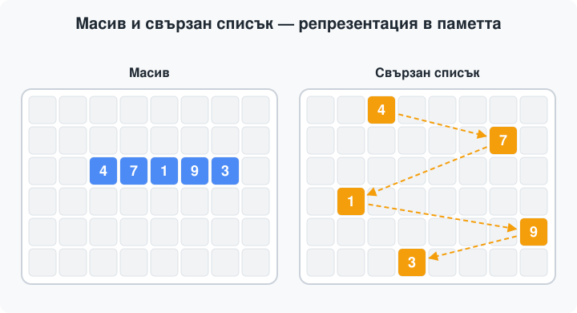

# Свързан списък (Linked List)

## 1. Кратък преговор: пойнтъри (указатели)

**Дефиниция:** Пойнтър е променлива, която съдържа адрес в паметта на друга променлива.

```cpp
int x = 42;
int* p = &x;      // p съдържа АДРЕСА на x

std::cout << p;   // напр. 0x7ffee3b9a4ac
std::cout << *p;  // 42 — отиваме по адреса и вземаме стойността
*p = 7;           // x вече е 7 (променяме стойността на мястото)
```

| синтаксис | какво прави |
| :--- | :--- |
| `int* p` | декларира `p` като пойнтър към `int` |
| `&x` | взема адреса на `x` |
| `*p` | достъпва стойността на мястото, което `p` сочи |
| `p->field` | достъп до член на структура: същото като `(*p).field` |

---
## 2. Абстрактна структура от данни

**Дефиниция:** Абстрактна структура от данни (АСД) е модел, който описва какви данни съхраняваме и какви операции можем да извършваме върху тях, без да уточнява как точно са реализирани тези операции.

Най-просто казано: описваме какво прави структурата, а не как работи отвътре.

---

## 3. Сравнение: масив VS свързан списък

### 3.1 Как изглеждат в паметта



* **Масив** — непрекъснат блок памет. Всеки елемент е на съседен адрес, затова адресът на `i`-тия елемент се изчислява, а не се търси:

  ```
  адрес на i-тия елемент = адрес на първия елемент + i * размер на един елемент 
  ```

* **Свързан списък** — възлите са разпръснати някъде в паметта. Връзката между тях държи указателят `next`. Адресът не се изчислява, до `i`-тия елемент се стига само като тръгнем от `head` и направим `i` стъпки.

### 3.2 Кеш локалност

- Масив: елементите се съхраняват последователно в паметта. Когато процесорът прочете един елемент, той често зарежда в кеша и съседните му елементи. Така при следващите достъпи данните вероятно вече ще са в кеша и ще се прочетат по-бързо (cache hit).

- Свързан списък: възлите могат да се намират на различни места в паметта. Когато процесорът премине към следващ възел чрез указателя next, необходимите данни може да не са в кеша. Тогава те трябва да се заредят от по-бавна памет (cache miss), което може да забави обхождането на списъка.

Извод: масивите често са по-бързи при последователно обхождане, защото използват по-добре кеша на процесора. Свързаните списъци могат да бъдат по-бавни, защото възлите им не са задължително разположени един до друг в паметта.

### 3.3 Сложност на основните операции

Сравнение за **масив** срещу **едносвързан списък без опашка** (без `tail`):

| операция | масив (`std::vector`) | едносвързан списък (без `tail`) |
| :--- | :--- | :--- |
| достъп по индекс `a[i]` | $O(1)$ | $O(N)$ |
| достъп до първия (`front`) | $O(1)$ | $O(1)$ |
| достъп до последния (`back`) | $O(1)$ | $O(N)$ — трябва обхождане |
| търсене на елемент | $O(N)$ | $O(N)$ |
| вмъкване в началото | $O(N)$ — местим всички | $O(1)$ |
| вмъкване в края | амортизирано $O(1)$ | $O(N)$ — трябва обхождане |
| изтриване в началото | $O(N)$ — местим всички | $O(1)$ |
| изтриване в края | $O(1)$ | $O(N)$ — търсим предпоследния |
| вмъкване/изтриване, ако вече държим възела | $O(N)$ — преместване | $O(1)$ |

**какво се наблюдава:** масивът е **бърз на достъп** (адресът се изчислява) и **бавен при вмъкване/изтриване** (елементите трябва да се преместят); списъкът е **бавен на достъп** (обхождаме) и **бърз при вмъкване/изтриване** (само пренасочване на указатели).

**защо вмъкването на елемент в края на масив(std::vector) е с константна сложност?**

- Операцията push_back() при std::vector има амортизирана константна сложност \(O(1)\), защото в повечето случаи добавянето на нов елемент става за постоянно време. Когато в масива има свободно място, елементът просто се записва в края му. Ако обаче капацитетът е запълнен, се заделя по-голям блок памет и всички съществуващи елементи се преместват в него, което отнема \(O(n)\) време. Това преоразмеряване не се случва при всяко добавяне, а сравнително рядко, тъй като капацитетът обикновено нараства геометрично.

### 3.4 Предимства на масива и свързания списък

Масивът (std::vector) е по-подходящ, когато:
- Трябва да достъпваме елементи по индекс — всеки елемент може да бъде достъпен директно за време \(O(1)\).
- Искаме бързо обхождане — елементите са разположени последователно в паметта, което подобрява използването на кеша на процесора.
- Искаме да използваме паметта ефективно — не е необходимо да съхраняваме указател към следващ елемент за всеки елемент от масива.

Свързаният списък е по-подходящ, когато:
- Добавяме или премахваме елементи в началото — операцията е \(O(1)\), тъй като не е необходимо да преместваме останалите елементи.
- Добавяме елементи в края — операцията е \(O(1)\), ако поддържаме указател към последния възел (tail).
- Добавяме или премахваме елемент на известна позиция — операцията може да бъде \(O(1)\), ако вече имаме указател към необходимия възел (и при изтриване на възел от едносвързан списък — обикновено и към предходния възел).
- Размерът на списъка се променя често — новите елементи се добавят чрез създаване на нови възли, без да е необходимо да се преместват съществуващите елементи в паметта.

---

## 4. Свързан списък (Linked List)

**Дефиниция:** Свързаният списък (Linked List) е линейна структура от данни, при която елементите се съхраняват във възли, разположени на различни, непоследователни адреси в паметта. Всеки възел съдържа данни и указател, който го свързва със следващ възел.

Всеки възел в свързания списък съдържа две основни части:
- Данни (`data/value`) — стойността, която се съхранява във възела.
- Указател (`next`) — пази адреса на следващия възел в списъка.

Възлите са свързани последователно чрез указателите next. За да имаме достъп до списъка, използваме указател head, който сочи към първия възел. Всеки следващ възел се достига чрез указателя на предходния, а последният възел съдържа nullptr в полето next, което показва, че няма следващ възел и списъкът завършва.

Например, ако списъкът съдържа стойностите `4`, `2` и `7`, връзките между възлите изглеждат така:

```text
  head
    |
    v
+-------+------+     +-------+------+     +-------+---------+
| data  | next |     | data  | next |     | data  | next    |
|   4   |   o--|---->|   2   |   o--|---->|   7   | nullptr |
+-------+------+     +-------+------+     +-------+---------+
```

### 4.1 Структура на един възел

Всеки възел (*node*) в едносвързания списък съдържа стойност и указател към следващия възел. В C++ възелът може да се дефинира по следния начин:

```cpp
struct Node {
    int data;
    Node* next;

    Node(int value) : data(value), next(nullptr) {}
};
```

### 4.2 Едносвързан списък без `tail`

При тази реализация списъкът използва само един указател — `head`, който сочи към първия възел. За да достигнем до останалите възли, следваме указателите `next` последователно.

Тъй като не поддържаме указател към последния възел, операциите в края на списъка изискват обхождане от началото.

- **`push_front(x)` — \(O(1)\):** добавя нов възел в началото, като неговият `next` сочи към досегашния първи възел. След това `head` се обновява да сочи към новия възел.
- **`pop_front()` — \(O(1)\):** премахва първия възел, като `head` се премества към следващия възел.
- **`push_back(x)` — \(O(N)\):** обхожда списъка до последния възел и свързва новия възел с него.
- **`pop_back()` — \(O(N)\):** обхожда списъка, за да намери предпоследния възел. След това задава неговия `next` на `nullptr` и премахва последния възел.

Тук \(N\) е броят на възлите в списъка. Основният недостатък на тази реализация е, че добавянето и премахването на елементи в края изискват обхождане на списъка.

### 4.3 Едносвързан списък с `tail`

При тази реализация списъкът използва два указателя — `head`, който сочи към първия възел, и `tail`, който сочи към последния възел. Така достъпът до края на списъка е директен и не е необходимо да се обхождат всички възли.

- **`push_front(x)` — \(O(1)\):** добавя нов възел в началото, като неговият `next` сочи към досегашния първи възел. След това `head` се обновява да сочи към новия възел.
- **`pop_front()` — \(O(1)\):** премахва първия възел, като `head` се премества към следващия възел. Ако списъкът остане празен, `tail` също се задава на `nullptr`.
- **`push_back(x)` — \(O(1)\):** свързва последния възел с новия възел и обновява `tail` да сочи към него. Ако списъкът е бил празен, `head` и `tail` сочат към новия възел.
- **`pop_back()` — \(O(N)\):** обхожда списъка, за да намери предпоследния възел. След това задава неговия `next` на `nullptr` и премества `tail` към него. Ако списъкът е съдържал само един възел, и двата указателя се задават на `nullptr`.

Основното предимство на тази реализация е, че добавянето на елемент в края има сложност \(O(1)\). Премахването от края обаче остава с линейна сложност \(O(N)\), защото едносвързаният списък не позволява директен достъп до предходния възел.

При двусвързан списък с `tail` операцията `pop_back()` има сложност \(O(1)\), тъй като всеки възел съдържа и указател към предходния възел.

### 4.4 Сложност на основните операции

Нека \(N\) е броят на възлите в списъка.

| Операция | Сложност без `tail` | Сложност с `tail` |
|---|---|---|
| `push_front` | \(O(1)\) | \(O(1)\) |
| `pop_front` | \(O(1)\) | \(O(1)\) |
| `push_back` | \(O(N)\) | \(O(1)\) |
| `pop_back` при едносвързан списък | \(O(N)\) | \(O(N)\) |
| `insertAt(i)` | \(O(N)\) | \(O(N)\) |
| `removeAt(i)` | \(O(N)\) | \(O(N)\) |
| Търсене на стойност | \(O(N)\) | \(O(N)\) |
| Достъп по индекс `get(i)` | \(O(N)\) | \(O(N)\) |

**Пояснение:**
- Операциите `insertAt(i)` и `removeAt(i)` са \(O(N)\), защото трябва да се обходи списъкът до съответната позиция. Ако вече разполагаме с указател към необходимия възел и предходния му възел, самата промяна на връзките е \(O(1)\).
---

## 5. Двусвързан списък (Doubly Linked List)

Двусвързаният списък е структура от данни, при която всеки възел съдържа стойност и два указателя към съседните възли. За разлика от едносвързания списък, при който можем да се движим само напред, тук можем да обхождаме елементите и в двете посоки, благодарение на допълнителния указател, който пазим във всеки елемент.

Всеки възел съдържа три полета:

- `prev` — указател към предишния възел;
- `data` — стойността, която съхранява възелът;
- `next` — указател към следващия възел.

### 5.1 Списък със и без `tail`

- `head` — сочи към първия възел;
- `tail` — сочи към последния възел.

С `tail`: имаме директен достъп до последния възел. Добавянето и премахването на елемент от края могат да се извършват за \(O(1)\).

**Без `tail`:** пазим само `head` и трябва да обходим списъка, за да достигнем последния възел. В този случай `pushBack` и `popBack` обикновено са \(O(N)\).

Указателят `prev` позволява движение назад от възел, до който вече имаме достъп. Той не осигурява директен достъп до последния елемент.

### 5.2 Сложност на операциите

Нека \(N\) е броят на възлите в списъка.

| Операция | Без `tail` | С `tail` |
|---|---|---|
| `push_front` | \(O(1)\) | \(O(1)\) |
| `pop_front` | \(O(1)\) | \(O(1)\) |
| `push_back` | \(O(N)\) | \(O(1)\) |
| `pop_back` | \(O(N)\) | \(O(1)\) |
| `insertAt(i)` | \(O(N)\) | \(O(N)\) |
| `removeAt(i)` | \(O(N)\) | \(O(N)\) |
| Търсене на стойност | \(O(N)\) | \(O(N)\) |
| Достъп по индекс `get(i)` | \(O(N)\) | \(O(N)\) |

### 5.3 Недостатъци

Основният недостатък на двусвързания списък е допълнителната памет, необходима за указателя `prev`.

Двусвързаният списък е подходящ, когато често се налага добавяне или премахване на елементи на известни позиции и е полезно да можем да се движим в двете посоки.

Ако обаче основната цел е бърз достъп по индекс и добра локалност на паметта, `std::vector` често е по-добрият избор.


---

## 6. Някои често срещани грешки и съвети

### 6.1 Достъп през нулев пойнтър: `nullptr->next`

Операторът `->` е валиден само върху ненулев пойнтър. `nullptr->next` е **undefined behavior** — на практика segmentation fault.

Лекарството е винаги едно и също — **проверяваме пойнтъра, преди да го разпакетираме**:

```cpp
if (cur != nullptr) {
    cur->next = node;   // вече е безопасно
}
```

### 6.2 Защо проверяваме първо `head`, после `head->next`?

Честият шаблон при задачи е:

```cpp
while (head != nullptr && head->next != nullptr) {
    // ...
}
```

**редът е въпрос на безопасност (short-circuit evaluation).**

`&&` в C++ се оценява **отляво надясно** и ако **първият** операнд е `false`, вторият **изобщо не се изчислява**. Първата проверка е пазач за втората:

| ред | какво се случва при `head == nullptr` |
| :--- | :--- |
| `head != nullptr && head->next != nullptr` | първата е `false` → втората **не се пипа** → безопасно |
| `head->next != nullptr && head != nullptr` | опитваме `nullptr->next` → **segmentation fault** |

### 6.3 Когато елементът се окаже head или tail

При всяко вмъкване/изтриване има три случая: първият възел, последният възел или възел по средата. Средата е тривиална. **Краищата са където списъкът се чупи**, защото освен връзките трябва да обновим и `head`/`tail`, за да остане списъкът във **валидно състояние**.

### 6.4 Загуба на връзката при презаписване на `next`

```cpp
// ГРЕШНО — изгубихме остатъка от списъка
cur->next = newNode;          // старото cur->next изчезна завинаги

// ВЯРНО — пазим връзката, преди да презапишем
Node* rest = cur->next;
cur->next = newNode;
newNode->next = rest;
```

---

## 7. Кратко сравнение

| операция | едносвързан без tail | едносвързан с tail | двусвързан без tail | двусвързан с tail | масив (`vector`) |
| :--- | :--- | :--- | :--- | :--- | :--- |
| добавяне на елемент в началото  | $O(1)$ | $O(1)$ | $O(1)$ | $O(1)$ | $O(N)$ |
| добавяне на елемент в края | $O(N)$ | $O(1)$ | $O(N)$ | $O(1)$ | амортиз. $O(1)$ |
| премахване на елемент от началото | $O(1)$ | $O(1)$ | $O(1)$ | $O(1)$ | $O(N)$ |
| премахване на елемент от края | $O(N)$ | $O(N)$ | $O(N)$ | $O(1)$ | $O(1)$ |
| достъп по индекс | $O(N)$ | $O(N)$ | $O(N)$ | $O(N)$ | $O(1)$ |
| търсене | $O(N)$ | $O(N)$ | $O(N)$ | $O(N)$ | $O(N)$ |
| обхождане назад | не | не | да, но първо $O(N)$ до края | да | да |
