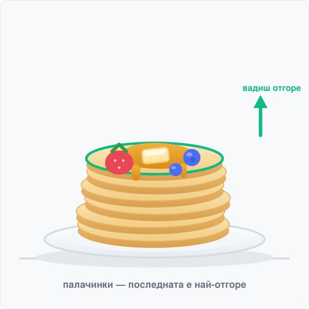
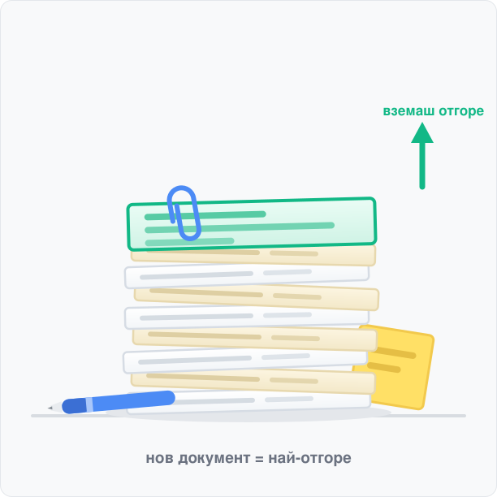
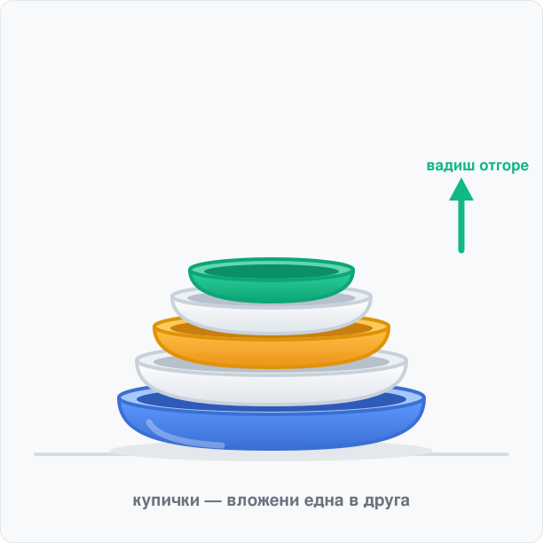
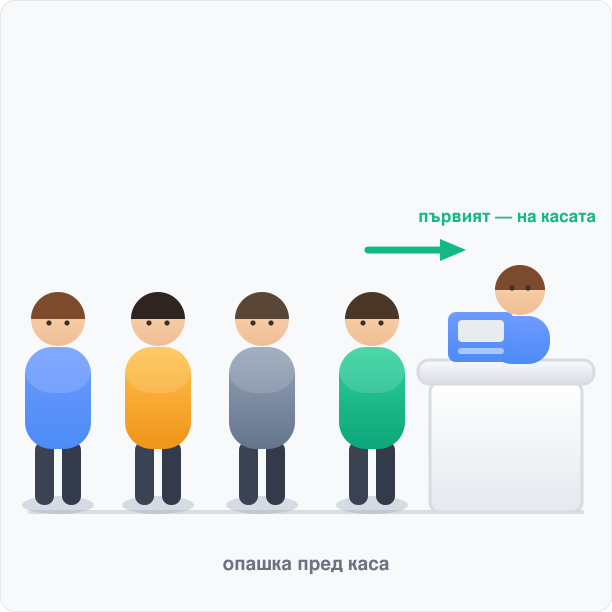
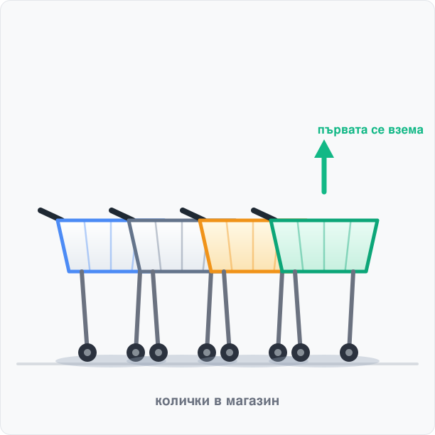

# Стек, опашка и дек (Stack, Queue и Deque)

## 1. Абстрактна структура от данни (АСД)

**Дефиниция:** Абстрактната структура от данни е модел, който описва **какви данни** съхраняваме и **какви операции** можем да извършваме върху тях, без да уточнява как точно са реализирани тези операции.

Най-просто казано: описваме **какво** прави структурата, а не **как** работи отвътре.

Клиентският код използва само абстрактните операции. Смяната на реализацията (масив ↔ свързан списък) не променя клиентския код.

Стекът, опашката и декът са класически примери за АСД — всеки от тях описва ограничен набор от операции и ограничава достъпа до елементите по определено правило (LIFO / FIFO, при дека — и от двата края).

---

## 2. Стек (Stack)

**Дефиниция:** Стекът е линейна структура от данни с достъп по правило **LIFO** — *Last In, First Out*. Последният добавен елемент е и първият, който се премахва.

Аналогия: купчина чинии — слагаш отгоре и махаш отгоре. Не можеш да вземеш чинията от средата на купчината.



Примери:
|  |  |  |
|------------------------|------------------------|------------------------|

### 2.1 Операции над стека

| операция | какво прави |
| :--- | :--- |
| `push(x)` | добавя елемент `x` на върха на стека |
| `pop()` | премахва елемента от върха на стека |
| `top()` | връща елемента от върха, **без** да го премахва |
| `empty()` | проверява дали стекът е празен |
| `size()` | връща броя на елементите |

Всички операции се извършват **само на върха**. Достъп до елементите по индекс или до елемента „по средата" няма — това е ограничение (и предимство) на АСД.

### 2.2 Реализация с масив (`std::vector`)

Идеята: **краят на масива е върхът на стека**. `push_back` добавя в края, `pop_back` маха от края — и двете са \(O(1)\).

### 2.3 Реализация със свързан списък

Идеята: **върхът на стека е `head` на списъка**. Добавяме и махаме винаги в началото на списъка — там операциите са \(O(1)\).

### 2.4 Сложност на операциите

| Операция | С масив (`vector`) | Със свързан списък |
|---|---|---|
| `push` | амортизирано \(O(1)\) | \(O(1)\) |
| `pop` | \(O(1)\) | \(O(1)\) |
| `top` | \(O(1)\) | \(O(1)\) |
| `empty` | \(O(1)\) | \(O(1)\) |
| `size` | \(O(1)\) | \(O(1)\) |

И двете реализации правят основните операции за константно време. Масивът е с по-добра локалност на паметта (елементите са един до друг), списъкът не изисква преоразмеряване, но плаща допълнителен указател на възел.

---

## 3. Опашка (Queue)

**Дефиниция:** Опашката е линейна структура от данни с достъп по правило **FIFO** — *First In, First Out*. Първият добавен елемент е и първият, който се премахва.

Аналогия: опашка пред щанда — първият застанал е и първият обслужен.



Примери:
|  |  |  |
|------------------------|------------------------|------------------------|

### 3.1 Операции над опашката

| операция | какво прави |
| :--- | :--- |
| `push(x)` | добавя елемент `x` в **края** (back) на опашката |
| `pop()` | премахва елемента от **началото** (front) на опашката |
| `front()` | връща елемента от началото, **без** да го премахва |
| `back()` | връща елемента от края, **без** да го премахва |
| `empty()` | проверява дали опашката е празна |
| `size()` | връща броя на елементите |

Добавянето става отзад, изваждането — отпред. Достъп до елементите по индекс няма.

### 3.2 Реализация със свързан списък

Идеята: пазим **два указателя** — `frontNode` (към първия възел) и `backNode` (към последния). Премахването е отпред, добавянето — отзад, и двете са \(O(1)\).

### 3.3. Реализация с цикличен масив

При тази реализация опашката се представя чрез масив с фиксиран размер. За следене на елементите се използват два индекса:

- front – сочи към първия елемент в опашката
- rear – сочи към последния добавен елемент

Първоначално и двата индекса са -1, което означава, че опашката е празна.

Добавяне на елемент: Проверява се дали опашката е пълна. Ако е празна, front и rear получават стойност 0. При всяко следващо добавяне rear се премества с една позиция напред. Ако достигне последната позиция на масива, се връща в началото, за да се използват освободените клетки.

Премахване на елемент: Премахва се първият елемент, като front се премества към следващия. Ако това е бил последният елемент, двата индекса се връщат на -1.

Опашката е пълна, когато следващата позиция след rear съвпада с front:

```cpp
(rear + 1) % capacity == front
```

По този начин масивът функционира като затворен кръг, при който след последната позиция следва отново първата. Това позволява ефективно използване на паметта, без преместване на елементите.

### 3.4 Сложност на операциите

| Операция | Със свързан списък | Кръгов буфер |
|---|---|---|
| `push` | \(O(1)\) | \(O(1)\) |
| `pop` | \(O(1)\) | \(O(1)\) |
| `front` / `back` | \(O(1)\) | \(O(1)\) |
| `empty` | \(O(1)\) | \(O(1)\) |
| `size` | \(O(1)\) | \(O(1)\) |

---

## 4. Дек (Deque)

**Дефиниция:** Декът (deque, съкр. от *double-ended queue*) е линейна структура от данни, при която **и добавянето, и премахването са възможни както от началото (front), така и от края (back)**.



### 4.1 Операции над дека

| операция | какво прави |
| :--- | :--- |
| `push_front(x)` | добавя елемент `x` в **началото** (front) на дека |
| `push_back(x)` | добавя елемент `x` в **края** (back) на дека |
| `pop_front()` | премахва елемента от **началото** на дека |
| `pop_back()` | премахва елемента от **края** на дека |
| `front()` / `back()` | връщат съответния край, **без** да премахват |
| `empty()` | проверява дали декът е празен |
| `size()` | връща броя на елементите |

Достъп до елементите по индекс или „по средата" пак няма.

---

## 5. `std::stack`, `std::queue` и `std::deque` от STL

В повечето задачи не пишете собствена реализация, а използвате готовите контейнери от STL:

| Контейнер | Документация (cplusplus.com) |
| :--- | :--- |
| `std::stack` | [`std::stack`](https://cplusplus.com/reference/stack/stack/) |
| `std::queue` | [`std::queue`](https://cplusplus.com/reference/queue/queue/) |
| `std::deque` | [`std::deque`](https://cplusplus.com/reference/deque/deque/) |

```cpp
#include <stack>
#include <queue>
#include <deque>

int main() {
    std::stack<int> s;
    s.push(10);
    s.push(20);
    s.top();      // 20
    s.pop();      // маха 20 — НЕ връща стойност!
    s.empty();    // false
    s.size();     // 1

    std::queue<int> q;
    q.push(10);
    q.push(20);
    q.front();    // 10 — първият добавен
    q.back();     // 20 — последният добавен
    q.pop();      // маха 10 — НЕ връща стойност!
    q.empty();    // false
    q.size();     // 1

    std::deque<int> d;
    d.push_back(10);
    d.push_front(20); // 20, 10
    d.front();        // 20 — началото
    d.back();         // 10 — краят
    d.pop_front();    // маха 20 — НЕ връща стойност!
    d.pop_back();     // маха 10
    d.empty();        // true
    d.size();         // 0
}
```

---

## 6. Някои често срещащи се грешки и съвети

### 6.1 Премахване от празен стек/опашка/дек

`pop()`/`pop_front()`/`pop_back()` и `top()`/`front()`/`back()` върху празна структура са **undefined behavior**. Винаги първо проверявай:

```cpp
if (!s.empty()) {
    int x = s.top();
    s.pop();
}
```

### 6.2 `pop()` не връща стойност

Класическа грешка с STL. `pop()` **не връща** премахнатия елемент — важи и за `pop_front()` / `pop_back()` при дека. Ако ти трябва стойността, първо вземи `top()` / `front()` / `back()`, чак после махай с `pop()`:

```cpp
// ГРЕШНО — s.top() след s.pop() четe следващия (или UB при празен стек)
s.pop();
int x = s.top();

// ВЯРНО
int x = s.top();
s.pop();
```

---
