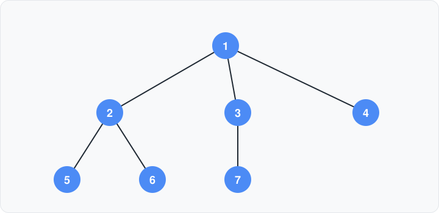

# Двоични дървета (Binary Trees)

## 1. Дърво (Tree)

**Дефиниция:** Дървото е нелинейна, йерархична структура от данни, съставена от множество възли (nodes), свързани помежду си чрез ребра. То има един начален възел, наречен корен (root), от който произлизат останалите възли. Всеки възел (с изключение на корена) има точно един родител и може да има нула или повече наследници (деца).

Дървото е свързан и ацикличен граф.

Аналогии: фамилно дърво, йерархия на папки във файловата система.



### 1.1 Основни понятия

 
| Понятие | Дефиниция |
| :--- | :--- |
| **Корен** | връх без предшественици; във всяко дърво има точно един |
| **Родител** | предшественик на наследник (пряк предшественик на върха) |
| **Дете** | пряк наследник |
| **Ребро** | пряка връзка между два върха |
| **Път** | поредица от ребра между върховете |
| **Дължина на път** | брой на ребрата, свързващи върховете |
| **Дълбочина на връх** | дължината на пътя от корена до върха |
| **Височина на дърво** | максималната дълбочина |
| **Разклоненост** | максималният брой ребра, излизащи от даден връх |
| **Листо** | връх без наследници |


**Полезно свойство:** броят на възлите е единица повече от броя на ребрата:

$$|V| = |E| + 1$$

**Две интуитивни обяснения за свойството:**

**Вариант 1:** Всеки възел в дървото, с изключение на корена, има точно един родител, докато коренът няма родител. Следователно всеки възел без корена има по едно съответстващо ребро, което го свързва с неговия родител. Затова броят на ребрата винаги е с едно по-малък от броя на върховете.

**Вариант 2:** Представяме си, че започваме с един-единствен връх, който представлява началото на дървото. В този момент имаме 1 връх и 0 ребра, тъй като няма друг връх, с който да бъде свързан. Всеки път, когато добавим нов връх към дървото, трябва да го свържем с вече съществуващ връх чрез едно ребро. По този начин с всяко добавяне броят на върховете и ребрата се увеличава с 1, като разликата между тях винаги остава 1. Затова можем да заключим, че броят на ребрата в едно дърво винаги е с едно по-малък от броя на върховете.

### 1.2 `Node` (общ случай)

В **общия случай** възелът държи данните и **списък с указатели към всичките си деца** — броят им е произволен (0, 1, 2, …).

```cpp
struct Node {
    int data;
    std::vector<Node*> children;

    Node(int data) : data(data) {}
};
```

---

## 2. Двоично дърво (Binary Tree)

**Дефиниция:** Двоично дърво е дърво, в което **всеки възел има най-много две деца** — наричани **ляво** (*left*) и **дясно** (*right*). Възелът може да има 0, 1 или 2 наследника; ако няма нито един, е **листо**. Позицията (ляво/дясно) има значение, но **стойностите в обикновеното двоично дърво нямат задължителна наредба** — такава се добавя при двоичното дърво за търсене.

**!Всяко двоично дърво за търсене е двоично дърво, но обратното не винаги е вярно!**

### 2.1 `Node` (при двоично дърво)

Всеки възел съдържа данни и указатели към левия и десния наследник.

```cpp
struct Node {
    int data;
    Node* left = nullptr;
    Node* right = nullptr;

    Node(int data, Node* left = nullptr, Node* right = nullptr)
        : data(data), left(left), right(right) {}
};
```

Обвивката около дървото обикновено пази един корен:

```cpp
class BinaryTree {
    Node* root = nullptr;

public:
    //some methods 
};
```

---

## 3. Двоично дърво за търсене (Binary Search Tree, BST)

**Дефиниция:** BST (двоично дърво за търсене) е двоично дърво, в което стойностите са подредени така, че за **всеки** възел x важи:

- всички стойности в **лявото** поддърво са **по-малки** от стойността в x
- всички стойности в **дясното** поддърво са **по-големи** от стойността в x
- и лявото, и дясното поддърво също са BST — затова дефиницията е **рекурсивна**, а **празното дърво е BST**.


**Важно:** За да се уверим, че едно дърво е валидно BST, не е достатъчно да сравняваме стойността на текущия възел само с неговите преки наследници. Необходимо е да проверим дали всички възли в лявото поддърво имат стойности, по-малки от тази на текущия възел, а всички възли в дясното поддърво – стойности, по-големи от нея. Това условие трябва да бъде спазено за всеки възел в дървото, за да можем да гарантираме, че то е валидно двоично дърво за търсене (BST).

### 3.1 Търсене (search)

Търсенето се възползва от наредбата в BST: на всеки възел сравняваме търсената стойност с тази във възела и продължаваме само в онова поддърво, където тя би могла да се намира. Ако стойността е по-малка, търсим в лявото поддърво, защото всички елементи в дясното са по-големи от възела и не могат да я съдържат. Ако е по-голяма, търсим в дясното, по същата причина. Така при всяка стъпка отпада цялото друго поддърво.

Търсенето приключва по един от два начина: намираме възел с търсената стойност (успех) или стигаме до `nullptr` (стойността я няма в дървото).



```cpp
bool search(Node* node, int x) {
    if (node == nullptr) 
        return false;   // стигнали сме празно място → няма го
    if (x == node->data) 
        return true;    // намерен

    if (x < node->data)  
        return search(node->left, x);
    else 
        return search(node->right, x);
}
```

### 3.2 Добавяне (insert)

Добавянето следва логиката на търсенето: започваме от корена и на всеки възел сравняваме новата стойност с тази във възела. Ако е по-малка, продължаваме наляво, а ако е по-голяма, надясно. Спираме, когато стигнем до `nullptr`. Това е мястото, където новият възел трябва да стои, и го създаваме там.

Функцията връща указател към корена на поддървото след добавянето на новия елемент. Родителският възел използва този указател, за да обнови връзката към своето дете (например node->left = insert(node->left, x)). По този начин новият възел се свързва правилно с дървото, като останалата му структура се запазва непроменена.

```cpp
Node* insert(Node* node, int x) {
    if (node == nullptr) 
        return new Node(x);

    if (x < node->data) {
        node->left = insert(node->left, x);
    } 
    else if (x > node->data) {
        node->right = insert(node->right, x);
    }
    
    return node;
}
```



### 3.3 Триене (delete)

При изтриване на възел със стойност `x` първо го намираме (както при търсене), а после действаме според броя на децата му:

1. **Листо (0 деца):** просто го премахваме. Родителят получава `nullptr` на негово място.
2. **Едно дете:** възелът се заменя с единственото си дете. Родителят се свързва директно с него, а поддървото му се запазва.
3. **Две деца:** не можем просто да го махнем, защото има две поддървета, а родителят може да поеме само едно. Затова:
   - намираме **наследника (successor)**: най-малкия елемент в дясното поддърво (най-левия му възел),
   - копираме стойността му във възела, който трием,
   - рекурсивно изтриваме наследника от дясното поддърво. Той няма ляво дете, така че това се свежда до случай 1 или 2.

   Може да се използва и **предшественикът (predecessor)**: най-големият елемент в лявото поддърво. Резултатът е еднакво правилен.

```cpp
Node* findMin(Node* root) {
    if (root == nullptr)
        return nullptr;

    while (root->left != nullptr) {
        root = root->left;
    }

    return root;
}

Node* deleteNode(Node* root, int key) {
    if (root == nullptr)
        return nullptr;

    if (root->data == key) {
        if (root->left == nullptr && root->right == nullptr) {
            delete root;
            return nullptr;
        }
        else if (root->left == nullptr || root->right == nullptr) {
            Node* toReturn = (root->left != nullptr ? root->left : root->right);
            delete root;
            return toReturn;
        }
        else {
            Node* minBigger = findMin(root->right);
            root->data = minBigger->data;
            root->right = deleteNode(root->right, minBigger->data);
        }
    }
    else if (root->data > key) {
        root->left = deleteNode(root->left, key);
    }
    else {
        root->right = deleteNode(root->right, key);
    }

    return root;
}
```

### 3.4 Сложност на операциите

Нека $N$ е броят на възлите:

| операция | worst case | average case |
| :--- | :--- | :--- |
| търсене | $O(N)$ | $\Theta(\log N)$ |
| добавяне | $O(N)$ | $\Theta(\log N)$ |
| триене | $O(N)$ | $\Theta(\log N)$ |
| обхождане | $O(N)$ | $\Theta(N)$ |

**Важно:** сложността зависи изцяло от **балансираността** на дървото! При вмъкване на сортирани ключове (1, 2, 3, 4, ...) BST-ът се изродява в линейна „змия" и операциите стават $O(N)$.

---

## 4. Алгоритми за обхождане на дървета

Примерите са за BST, но важат за **всяко** двоично дърво. Обхожданията се делят на:

- **DFS (Depth-First Search)** — в дълбочина: *inorder, preorder, postorder*
- **BFS (Breadth-First Search)** — в широчина: *level order* (ниво по ниво)

Примерно дърво, използвано по-долу:

```
        8
      /   \
     3     10
    / \      \
   1   6      14
```



### 4.1 Inorder — Ляво, Корен, Дясно

- Извежда стойностите на BST **във възходящ ред**.
- Схема: *Ляво → Корен → Дясно*
- За примера: `1 3 6 8 10 14`

```cpp
void inorder(Node* node) {
    if (node == nullptr) 
        return;

    inorder(node->left);
    std::cout << node->data << " ";
    inorder(node->right);
}
```

### 4.2 Preorder — Корен, Ляво, Дясно

- Схема: *Корен → Ляво → Дясно*
- За примера: `8 3 1 6 10 14`

```cpp
void preorder(Node* node) {
    if (node == nullptr) 
        return;

    std::cout << node->data << " ";
    preorder(node->left);
    preorder(node->right);
}
```

### 4.3 Postorder — Ляво, Дясно, Корен

- Схема: *Ляво → Дясно → Корен*
- За примера: `1 6 3 14 10 8`

```cpp
void postorder(Node* node) {
    if (node == nullptr) 
        return;

    postorder(node->left);
    postorder(node->right);
    std::cout << node->data << " ";
}
```

### 4.4 Итеративен DFS със стек

Първите три обхождания **„невидимо" използват стек** — това е системният стек при рекурсията. Същото може да се направи и с **явен стек**.

### 4.5 Breadth-First Search (Level Order)

- Обхожда **ниво по ниво**: корен → дълбочина 1 → дълбочина 2 → ...
- За примера: `8` → `3 10` → `1 6 14`
- Реализира се с **опашка (queue)**:

```cpp
void levelByLevel(const Node* root) {
    if (root == nullptr) return;

    std::queue<const Node*> q;
    q.push(root);

    while (!q.empty()) {
        size_t levelSize = q.size();   // брой възли в текущото ниво

        for (size_t i = 0; i < levelSize; i++) {
            const Node* cur = q.front();
            q.pop();
            std::cout << cur->data << " ";

            if (cur->left != nullptr)
                q.push(cur->left);
            if (cur->right != nullptr)
                q.push(cur->right);
        }
        std::cout << " ";             // край на нивото
    }
}
```

Как работи:

1. Първото ниво — слагаме **корена** в опашката.
2. Махаме върха от опашката и добавяме **неговите деца** в края ѝ.
3. Повтаряме, докато опашката не се изпразни — така възлите се извеждат ред по ред, ниво по ниво.



**Най-кратък път:** ако **ребрата са без тегла** (всеки ръб „тежи" 1), BFS/levelOrder винаги стига всеки възел по **най-краткия възможен път** от корена — защото обхожда ниво по ниво и първият път, по който достигне даден възел, е именно този с минимален брой ребра. Затова дълбочината на възела съвпада с дължината на най-краткия път до него. При теглени ребра това вече не важи — там най-краткият път се намира с алгоритми като Dijkstra.

### 4.6 Сложност на обхожданията

| обхождане | време |
| :--- | :--- |
| inorder / preorder / postorder (рекурсивно) | $O(N)$ |
| итеративен DFS със стек | $O(N)$ |
| BFS (level order) с опашка | $O(N)$ |

---

## 5. Балансирани дървета

**Балансирано дърво** е дърво с височина $H = O(\log N)$ — тогава търсене, вмъкване и триене са $O(\log N)$. При изродено (линейно) дърво $H = N$ и операциите падат до $O(N)$.

Балансът се поддържа чрез **ротации** при всяко вмъкване/триене. Дърветата, които го правят автоматично, се наричат **самобалансиращи се**: **AVL** (строго правило — разликата във височините на лявото и дясното поддърво е най-много 1, но по-чести ротации) и **червено-черно** (по-слабо правило и по-рядко балансиране — върху него са построени `std::map` и `std::set`).

---

## 6. STL `map` и `set`

### 6.1 Какво стои отдолу — червено-черно дърво

Контейнерите `std::set` и `std::map` са *ordered* — **„Behind the scenes" са червено-черни дървета**.

| контейнер | документация |
| :--- | :--- |
| `std::set` | [cplusplus.com — set](https://cplusplus.com/reference/set/set/) |
| `std::map` | [cplusplus.com — map](https://cplusplus.com/reference/map/map/) |

### 6.2 `std::set` — множество без дубликати

`set` държи **уникални елементи**, винаги подредени по големина. Основните операции:

```cpp
#include <set>
#include <iostream>

int main() {
    std::set<int> s = {5, 1, 3, 5, 3};  // {1, 3, 5} — дубликатите изчезват

    s.insert(4);                         // {1, 3, 4, 5}
    s.count(3);                          // 1 — има го
    s.count(10);                         // 0 — липсва
    s.size();                            // 4

    // обхождане = възходящ ред (inorder)
    for (int x : s)
        std::cout << x << ' ';           // 1 3 4 5

    // търсене
    s.find(3) != s.end();                // true — намерен
    s.find(99) == s.end();               // true — не е намерен
}
```

### 6.3 `std::map` — асоциативен масив (ключ → стойност)

`map` държи двойки **ключ → стойност**, подредени по **ключа**:

```cpp
#include <map>
#include <string>
#include <iostream>

int main() {
    std::map<std::string, int> grades;

    grades["Pesho"] = 6;                 // създава запис, ако липсва
    grades["Gosho"] = 5;
    grades.insert({"Ivan", 4});

    grades["Pesho"];                     // 6
    grades.count("Pesho");               // 1
    grades.size();                       // 3

    if (grades.find("Stancho") == grades.end())
        std::cout << "няма такъв ученик\n";
}
```

**Внимание с `operator[]`:** ако ключът липсва, `grades["Stancho"]` **създава** нов запис със стойност по подразбиране (`0` за `int`). Затова при само четене ползвай `find`, `count` или `at`.

### 6.4 Сложност на операциите

| операция | `set` / `map` |
| :--- | :--- |
| `insert`, `find`, `count`, `erase` | $O(\log N)$ |
| достъп `m[key]` | $O(\log N)$ |
