# Хеш таблици и хеш множества (Hash Map и Hash Set)

## 1. Хеш функция

**Дефиниция:** Хеш функцията е функция, която преобразува обект в число в определени граници.

Свойства на добрата хеш функция:

- Трябва да е **бърза** — извиква се при всяка операция (добавяне, търсене, изтриване).
- Трябва да връща **винаги един и същи резултат** за един и същи обект — иначе не можем да намерим елемента, който сме записали.
- Желателно е да разпределя стойностите **максимално равномерно** в интервала — така намаляваме колизиите.

---

Еднаквите обекти **винаги** имат еднакъв хеш:

$$x = y \Rightarrow hashFunction(x) = hashFunction(y)$$

Обратното обаче **не е вярно:** съвпадението на хешовете не означава, че обектите са равни:

$$hashFunction(x) = hashFunction(y) \not\Rightarrow x = y$$

С други думи, **два различни обекта могат да получат една и съща хеш стойност**. Именно това се нарича **колизия**.

---

## 2. Хеш множество (Hash Set)

**Дефиниция:** Хеш множеството е ненаредена структура от данни, която съхранява уникални обекти и позволява проверката дали даден обект вече е добавен да се извършва със сложност $O(1)$ в средния случай.

За разлика от хеш таблицата, хеш множеството съхранява само самите елементи (ключове), без да им съпоставя стойности.

---

## 3. Хеш таблица (Hash Table / Hash Map)

**Дефиниция:** Хеш таблицата е ненаредена структура от данни, която съхранява двойки (ключ, стойност) и позволява добавянето и премахването (амортизирано $O(1)$), както и търсенето по ключ ($O(1)$) да се извършват със сложност в средния случай.

За разлика от хеш множеството, тя съхранява не само ключове, а и стойности, като всяка стойност е свързана със съответния ключ.

---

<!--
## 4. Основна идея (обща за хеш сет и хеш мап)

И хеш множеството, и хеш таблицата стоят върху **един и същ** механизъм: **масив + хеш функция**. Затова примерът по-долу важи и за двете — разликата е само какво държим в клетката:

- **set** (`unordered_set`): в клетката стои **самият елемент** — например `12`;
- **map** (`unordered_map`): в клетката стои **двойка (ключ, стойност)** — например `12 → възраст 20`.

Ако имаме хешираща функция, която хешира ключовете в интервала $0..K$, бихме могли да използваме **масив от $K$ елемента** — от хеширащата функция ще разберем **в коя клетка** да пишем. Търсенето се превръща в изчисляване на един индекс и директен достъп до клетката — без обхождане на масива.

**Пример с хешираща функция по модул 5** (показваме само елементите, както при сет; при мап на всяко място щеше да стои двойка `ключ → стойност`):

```
hashFunction(k) = k mod 5
```

Функцията взема ключа (цяло число) и връща **остатъка от деление на 5**. При деление на 5 остатъкът винаги е едно от $0, 1, 2, 3, 4$ — точно толкова са и клетките на масива, затова резултатът от функцията **е готов индекс**:

**1.** `insert(12)` → `12 % 5 = 2` → клетка 2:

```cpp
//   0     1     2     3     4
//  [__]  [__]  [12]  [__]  [__]
```

**2.** `insert(23)` → `23 % 5 = 3` → клетка 3:

```cpp
//   0     1     2     3     4
//  [__]  [__]  [12]  [23]  [__]
```

**3.** `insert(9)` → `9 % 5 = 4` → клетка 4:

```cpp
//   0     1     2     3     4
//  [__]  [__]  [12]  [23]  [9]
```

До тук всеки елемент си има **собствена клетка** — и при сет, и при мап операцията е една и съща: изчисляваме индекса и записваме на това място.

**4.** `insert(7)` → `7 % 5 = 2` → клетка 2:

```cpp
insert(7);    // 7 % 5 = 2 → клетка 2, но тя вече е заета от 12!

//   0     1     2     3     4
//  [__]  [__]  [12]  [23]  [9]
//                 ↑
//          колизия: и 7 иска клетка 2
```

Ключовете `12` и `7` дават **една и съща** хеш стойност ($12 \bmod 5 = 7 \bmod 5 = 2$) — това е **колизия** и не знаем къде точно да запишем `7`. Проблемът е еднакъв и за сет, и за мап. Как да се разреши?
-->

## 4. Разрешаване на колизии (Collision resolution)

### 4.1 Основен проблем — колизии

**Колизия** — два обекта имат една и съща хеш стойност: $$hashFunction(x) = hashFunction(y)$$

Двата обекта са различни, но поради ограничението в размера на пространството за хеширане техните стойности съвпадат.

Колизиите са **неизбежни** (повече обектите отколкото клетки), затова трябва стратегия за разрешаването им.

### 4.2 Какво правим, ако има колизия?

Основни стратегии:

1. **Запазване на няколко стойности в една клетка** → *separate chaining*
2. **Използване на следваща празна клетка** → *linear probing*
3. **Използване на няколко хеширащи функции** → *double hashing*

### 4.3 Separate chaining (няколко стойности в една клетка)

**Идея:** Всяка клетка пази **списък** с всички двойки, чийто хеш съвпада — при търсене първо смятаме индекса, после обхождаме само списъка в клетката.



| операция | среден случай | най-лош случай |
| :--- | :--- | :--- |
| вмъкване | $O(1)$ амортизирано | $O(n)$ |
| търсене | $O(1)$ | $O(n)$ |
| изтриване | $O(1)$ | $O(n)$ |

При добра хеш функция и умерена пълнота списъците са къси → константа в средния случай. В най-лошия случай **всички елементи са в един списък** → $O(n)$.

### 4.4 Linear probing (търсене на следваща празна клетка)

**Идея:** Ако клетката е заета, пробираме **напред клетка по клетка**, докато намерим празна.



**Кластериране:** Съседните клетки се заемат на групи (кластери) — новите елементи попадат в тях и ги разширяват, а търсенето става все по-бавно. Затова таблицата не бива да е прекалено гъста (аналогия: претъпкан паркинг — колкото по-малко свободни места, толкова по-дълго се търси).

**Изтриване:** Не можем просто да оставим дупка — търсенето спира при първата празна клетка и никога не стига елементите зад нея. Вместо това отбелязваме клетката като `DELETED` (`TOMBSTONE`): търсенето продължава през нея, а при вмъкване клетката може да се преизползва.

### 4.5 Double hashing (двойно хеширане)

**Идея:** Две хеш функции — $h_1$ дава началната позиция, а при колизия $h_2$ задава **стъпката** на търсене:

```cpp
int i = (h1(key) + step * h2(key)) % M;   // step = 0, 1, 2, ...
```

Стъпката е различна за всеки ключ — за разлика от фиксираната 1 при linear probing, пътищата се разнасят и кластерите не се трупат.



### 4.6 Увеличаване на големината на таблицата (Resizing)

Когато броят на елементите нарасне твърде много спрямо броя на клетките, достъпът се забавя — от $O(1)$ към $O(n)$.

**Решение:** следим съотношението $N/M$ (брой елементи / брой клетки, нарича се *load factor*) и когато стане твърде голямо — **увеличаваме размера на таблицата**, а когато е твърде малко — намаляваме. След промяната **всички елементи се пре-хешират** (rehash), защото индексите се изчисляват по новата големина на таблицата.

---

## 5. Хеш таблица срещу балансирано дърво (обобщение)

Хеш таблиците и балансираните дървета са доста оптимални структури за съхранение и търсене:

- При **балансираните дървета** имаме **гарантирана сложност в най-лошия случай** от $O(\log n)$ за основните операции (добавяне, изтриване, търсене).
- При **хеш таблицата** нямаме такава гаранция в най-лошия случай, но **практически** в средния случай работи по-добре и по-бързо от балансираните дървета.

| операция | хеш таблица (среден) | хеш таблица (най-лош) | балансирано дърво |
| :--- | :--- | :--- | :--- |
| добавяне | $O(1)$ амортизирано | $O(n)$ | $O(\log n)$ |
| търсене | $O(1)$ | $O(n)$ | $O(\log n)$ |
| изтриване | $O(1)$ | $O(n)$ | $O(\log n)$ |

**Защо амортизирано при добавяне:** от време на време таблицата се преоразмерява и **всички елементи се пре-хешират**. Тази операция е скъпа ($O(n)$), но се случва рядко, затова „средната" цена на едно вмъкване остава константна.

**Защо в най-лошия случай е линейно $O(n)$:** ако хеш функцията е лоша (или всички ключове попадат в една и съща клетка), цялата таблица се свива до **един списък/клъстер с $n$ елемента**:

- при *separate chaining* всички $n$ двойки са в един свързан списък → търсенето обхожда целия списък → $O(n)$;

В този случай хеш таблицата губи предимството си и деградира до **обикновен списък** — затова в таблицата най-лошият случай е $O(n)$, докато балансираното дърво **гарантира** $O(\log n)$ независимо от подредбата на данните. Практически обаче, при добра хеш функция и разумно преоразмеряване, този случай е изключително рядък.

Избор: когато искаме **скорост и не ни пука от наредба** → хеш таблица. Когато ни е нужна **гаранция и подредба по ключ** → балансирано дърво.

---

## 6. Структурите в C++

| структура от данни | контейнер в STL | документация |
| :--- | :--- | :--- |
| Hash map | `std::unordered_map` | [cplusplus.com — unordered_map](https://cplusplus.com/reference/unordered_map/unordered_map/) |
| Hash set | `std::unordered_set` | [cplusplus.com — unordered_set](https://cplusplus.com/reference/unordered_set/unordered_set/) |
| Balanced tree map | `std::map` | [cplusplus.com — map](https://cplusplus.com/reference/map/map/) |
| Balanced tree set | `std::set` | [cplusplus.com — set](https://cplusplus.com/reference/set/set/) |

```cpp
#include <unordered_set>
#include <iostream>

int main() {
    std::unordered_set<int> s = {5, 1, 3, 5, 3};  // {1, 3, 5} — без дубликати, без наредба

    s.insert(4);
    s.count(3);                                    // 1 — има го
    s.count(10);                                   // 0 — липсва

    s.find(3) != s.end();                          // true — намерен
    s.find(99) == s.end();                         // true — не е намерен
}
```

```cpp
#include <unordered_map>
#include <iostream>

int main() {
    std::unordered_map<std::string, int> umap;
    umap["Ivan"] = 10;
    umap["Petar"] = 20;
    umap["Vasil"] = 30;
    std::cout << umap["Ivan"] << '\n';   // 10

    // няма подредба — обхождането е в произволен ред
    for (const auto& pair : umap)
        std::cout << pair.first << ' ' << pair.second << '\n';
}
```

---

## 7. Някои често срещани грешки и съвети

### 7.1 `operator[]` създава запис при липсващ ключ

Ако ключът липсва, `m[key]` **го създава** със стойност по подразбиране (`0` за `int`).

Това е удобно при запис: `freq[w]++` създава ключа, ако го няма, и веднага го увеличава с едно. При четене обаче е добре първо да провериш дали ключът изобщо съществува, защото иначе липсващият ключ се добавя в таблицата.

### 7.2 Няма наредба

`std::unordered_map` / `std::unordered_set` обхождат елементите в **произволен ред**. Ако ти трябва сортирано обхождане или търсене на „следващия" ключ — ползвай `std::map` / `std::set` ($O(\log n)$).

---

## 8. Техники: Prefix Sum и Rolling Hash

### 8.1 Prefix Sum

**Дефиниция:** Техника, при която предварително изчисляваме сумите от началото на масива до всяка позиция, за да отговаряме на запитвания за сума на подмасив за $O(1)$.

Ако $a_1, a_2, \ldots, a_n$ са елементите, дефинираме префиксна сума:

$$S_0 = 0, \qquad S_i = a_1 + a_2 + \cdots + a_i$$

Сумата на интервала $[l, r]$ (включително) се получава с:

$$\text{sum}(l, r) = S_r - S_{l-1}$$

### 8.2 Rolling Hash

**Дефиниция:** Техника, при която хешът на низ се преизчислява за $O(1)$ при „подвигане" (преместване на прозореца) с една позиция напред, вместо да се смята наново за $O(n)$.

**Идея:** Третираме низа като число в система с основа $B$ (напр. $B = 31$ или $B = 131$) по модул $M$ (напр. $M = 2^{64}$ или големо просто число):

$$H(s) = s_0 \cdot B^{n-1} + s_1 \cdot B^{n-2} + \cdots + s_{n-1} \cdot B^0$$

Хешът на подниза $s[l \ldots r]$ (дължина $k$) се получава, като **махаме водещата цифра и добавяме нова**:

$$H_{\text{нов}} = \big(H_{\text{стар}} - s_{\text{стар}} \cdot B^{k-1}\big) \cdot B + s_{\text{нов}}$$

---

## 9. Задачи за упражнение

### Easy

- [Isomorphic Strings](https://leetcode.com/problems/isomorphic-strings/)
- [Contains Duplicate II](https://leetcode.com/problems/contains-duplicate-ii)
- [Missing Number](https://leetcode.com/problems/missing-number)

### Medium

- [Longest Consecutive Sequence](https://leetcode.com/problems/longest-consecutive-sequence)
- [Longest Substring Without Repeating Characters](https://leetcode.com/problems/longest-substring-without-repeating-characters/)
- [Group Anagrams](https://leetcode.com/problems/group-anagrams)
- [Special Triples](https://www.hackerrank.com/contests/sda-hw-9-2022/challenges/challenge-3771/)
- [Count Number of Bad Pairs](https://leetcode.com/problems/count-number-of-bad-pairs)
- [Contiguous Array](https://leetcode.com/problems/contiguous-array/) (HackerRank: [0-1 Subarray](https://www.hackerrank.com/contests/sda-homework-9/challenges/0-1-1))
- [Subarray Sum Equals K](https://leetcode.com/problems/subarray-sum-equals-k)
- [Repeated DNA Sequences](https://leetcode.com/problems/repeated-dna-sequences)

### Бонус

- [LRU Cache](https://leetcode.com/problems/lru-cache/)
- [LFU Cache](https://leetcode.com/problems/lfu-cache/description/)